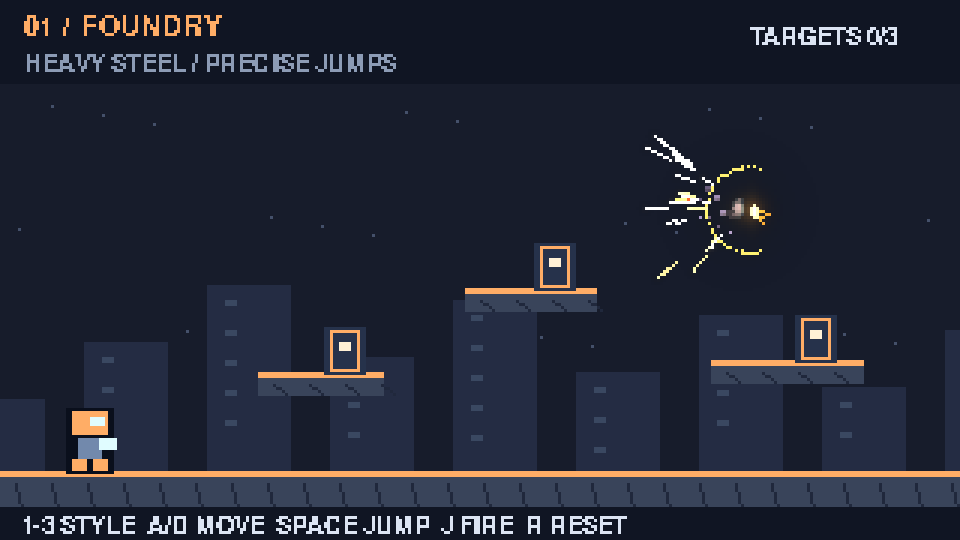
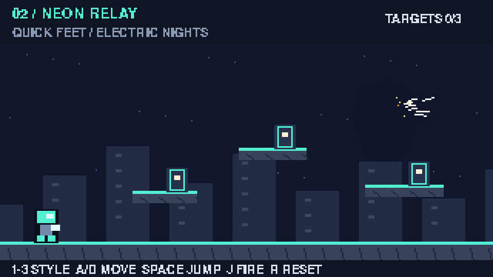
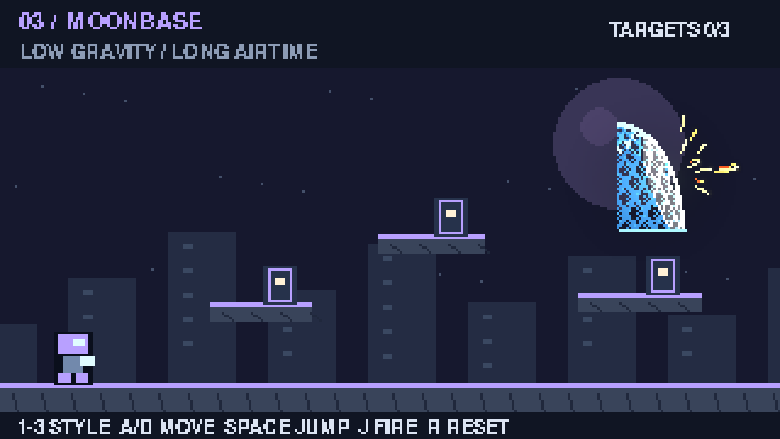

# project_red

A fun Python action-platformer learning project inspired by Mega Man, with PixelFX effects.

Three playable taste samples are ready. Run, jump, and shoot three practice targets while comparing movement and art directions.

| Key | Sample | Feel |
| --- | --- | --- |
| 1 | Foundry | Warm steel, deliberate movement, punchy impacts |
| 2 | Neon Relay | Teal night skyline, fast movement, electric sparks |
| 3 | Moonbase | Violet lunar skyline, low gravity, shield flashes |





## Play on Windows

Install Python 3.12 or newer, then run these commands from the repository folder:

```powershell
python -m venv .venv
.venv\Scripts\python -m pip install -r requirements.txt
.venv\Scripts\python game.py
```

Tested here with Python 3.15.1 and pygame-ce 2.5.8. On macOS/Linux use `.venv/bin/python` instead.

A/D or arrows move; Space jumps; hold J to shoot; R resets; 1/2/3 switches samples; Escape pauses. Close the window to quit. Jump toward the platforms and shoot the targets at their height. Each style starts fresh when selected.

These are small feel experiments, not a full game: no enemy damage, audio, scrolling, boss, or final character art yet. Pick a favorite movement feel and palette before expanding the level.

## Explore and learn

Read [the GitHub exploration notes and asset credits](docs/SAMPLES.md) and [the roadmap](PLAN.md). The game logic and original geometric artwork are in `game.py`; real PixelFX exports supply the impact animations. Players do not need Node.js.

```powershell
.venv\Scripts\python -m unittest discover -s tests -v
.venv\Scripts\python game.py --sample 2
.venv\Scripts\python game.py --screenshots docs/previews
```

The preview command renders staged effect examples and exits. Tests cover physics and animation loading; they do not replace human feedback on game feel.
